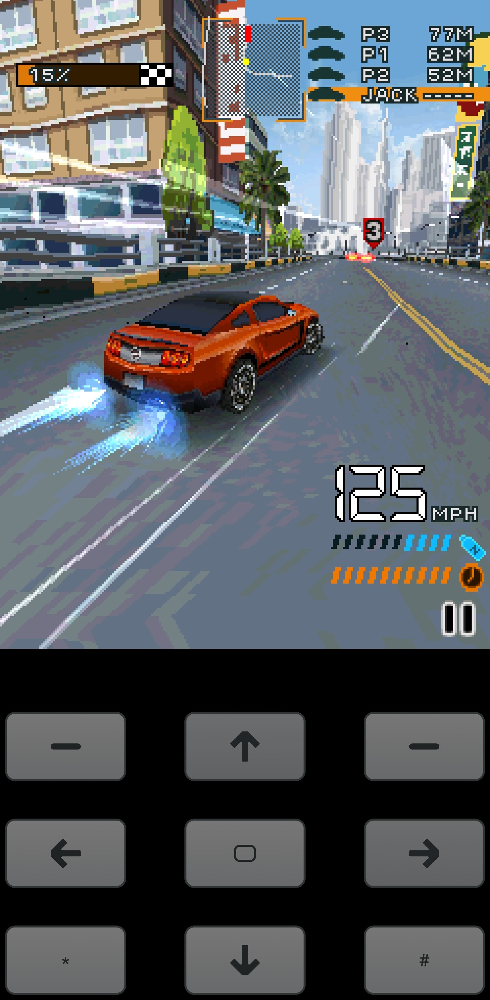
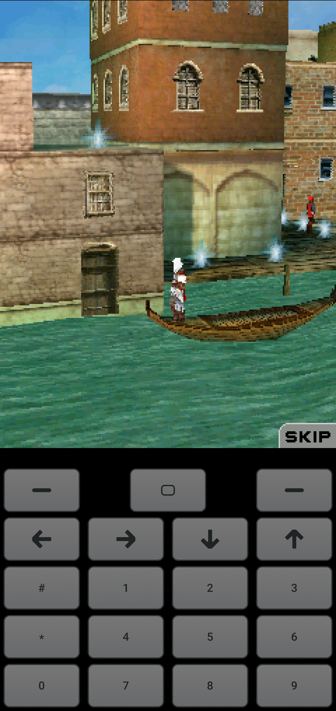
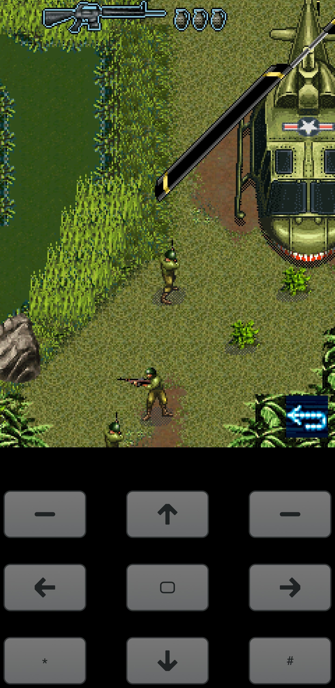
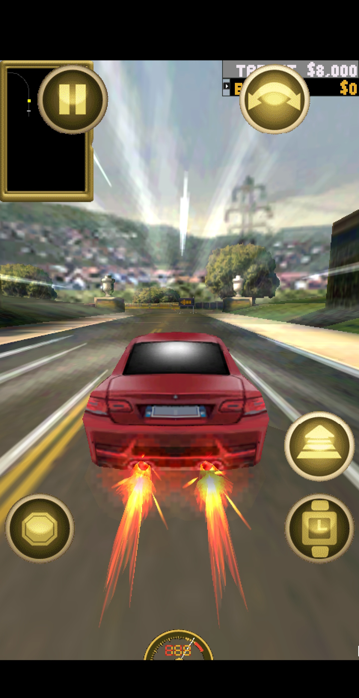
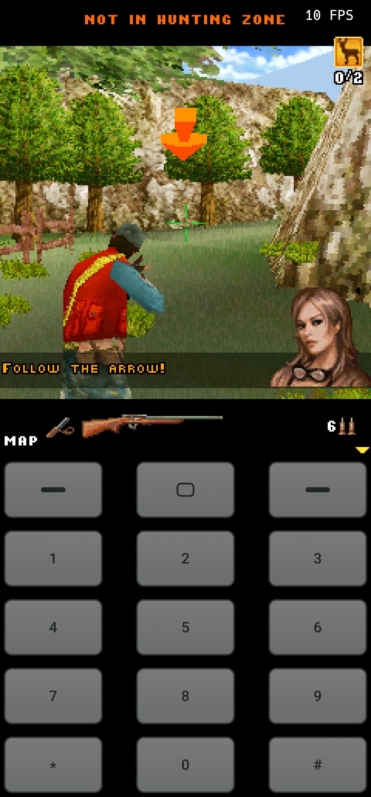
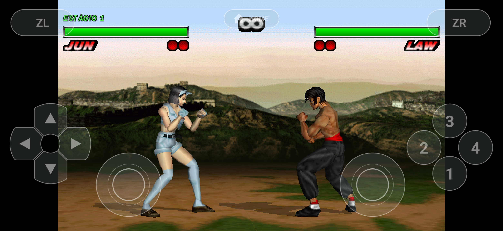
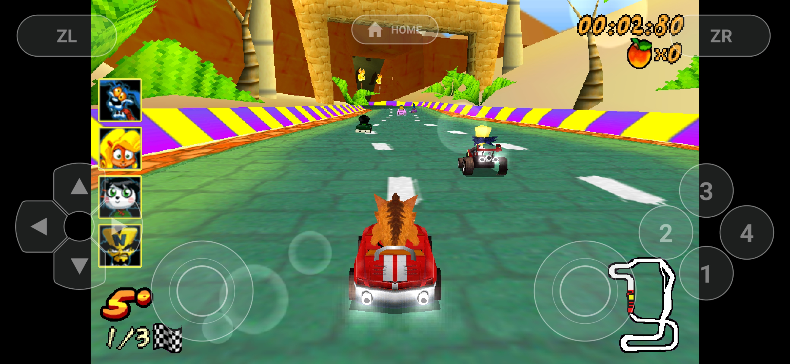

# Brew2Droid

Brew2Droid is an Android emulator for BREW cellphone and Zeebo games, bringing classic mobile and console software to modern ARM64 Android devices.

The project is under active development. Compatibility and performance vary between games, versions, and devices.

## Join the official Pocket2Droid Discord for news, updates and support.

- [Discord](https://discord.gg/cVHYSwn9Bq)
- [YouTube](https://www.youtube.com/@Pocket2Droid)

## Features

- Support for ARM64 Android devices.
- Cellphone and Zeebo on-screen controls.
- Customizable cellphone button layouts.
- Default, D-Pad, and NumPad layout presets.
- Keyboard and controller button mapping.
- Analog controls for Zeebo games.
- Per-game resolution, orientation, scaling, and control profiles.
- Hardware-accelerated graphics.
- Sound and volume settings.
- Chinese text: the game keeps its own font, and the characters it lacks come from the system CJK
  font (Noto Sans CJK on Android), read on demand. Japanese and Korean work the same way, and so do
  Cyrillic, Greek and Vietnamese (see [Fonts](#fonts)).

### Fonts

A game draws text with the `.ttf` it ships. A translation replaces the strings and not the font, and
a font like the 191 KB `tectoy.ttf` has no ideograph at all — every character of a Chinese
translation came out blank, leaving only digits and punctuation. When the game's font does not draw
a character, the emulator looks for a CJK fallback, in this order:

1. `ZEEBX_CJK_FONT` — a path, for pinning one specific font;
2. `<device root>/shared/fonts/` — drop a `.ttf`/`.otf`/`.ttc` there to use it;
3. the Android system fonts — `/system/fonts` and `/product/fonts` (`Noto Sans CJK`,
   `Noto Sans SC`, `Droid Sans Fallback`);
4. the desktop fonts, when running on a PC.

Several candidates are kept because none covers every ideograph: `Noto Sans SC` has about 30 000
glyphs, `Droid Sans Fallback` far fewer, and the game may ship a font with no CJK at all. Each is
read **only when a character needs it** — loading the 20 MB CJK font to draw a Portuguese menu would
be wasted memory.

The fallback is only consulted for characters the game's font does not have, and it is scaled to the
same `em`, so the Latin text keeps the look and the line height the game was designed around. If the
game ships no font at all, the system font becomes the main one. `.ttc` collections are opened on the
face that draws the text — the Simplified Chinese one for a Chinese string, the Japanese one is never
picked by accident.

Line breaking follows the script too: Chinese, Japanese and Korean have no spaces between words, so
they break between characters, and closing punctuation never starts a line.

**Scope.** Only CJK is wired up, on purpose. Arabic, Hebrew, Devanagari, Thai and Khmer fonts are
installed on Android and would be easy to add, but this engine draws one character at a time: Arabic
letters would not join and would read left to right, Thai vowels would not stack, Devanagari
conjuncts would not form. The glyphs would appear and the words would be wrong — which looks like a
game bug. Doing it properly needs a shaping engine (HarfBuzz) and a bidi pass, which this port does
not have yet. Latin, Greek, Cyrillic, Vietnamese and CJK need neither shaping nor bidi, and are
correct.

## Screenshots

<!-- screenshots:start -->

| Racing · D-Pad controls | Assassin's Creed II 3D | Action · D-Pad controls |
| :---: | :---: | :---: |
|  |  |  |

| Touchscreen racing | Hunting · NumPad controls |
| :---: | :---: |
|  |  |

| Tekken · Zeebo controls | Crash Bandicoot · Zeebo controls |
| :---: | :---: |
|  |  |

<!-- screenshots:end -->

## Requirements

- Android 8.0 or newer.
- An ARM64 device.
- Compatible game packages with their required data files.

Games, firmware, and SoundFont banks are not included.

## Download

Download APK builds from the [Releases page](https://github.com/samsixx6/Brew2Droid/releases).

Development releases are previews and may contain bugs.

## Getting Started

1. Download and install the APK.
2. Open Brew2Droid and allow storage access when prompted.
3. Place your game folders in `Internal storage/brew2droid/Games`.
4. Keep each game's complete folder structure, including its MOD, MIF, and required data files.
5. Select **Refresh** from the game library's settings menu.
6. Choose a game and configure its display and controls as needed.

## Reporting Problems

Report bugs through [GitHub Issues](https://github.com/samsixx6/Brew2Droid/issues).

Please include:

- Brew2Droid version.
- Device model and Android version.
- Exact game title and version.
- A screenshot or relevant log, when available.

## Building

See [BUILDING.md](BUILDING.md) for dependencies and build instructions.

## License

The source code is licensed under **GPL-2.0-or-later**. Android binaries are distributed under **GPLv3** because of their linked dependencies.

See [LICENSE](LICENSE), [LICENSE-GPL3](LICENSE-GPL3), and [THIRD-PARTY-NOTICES.txt](THIRD-PARTY-NOTICES.txt). Existing copyright and license notices must be preserved when redistributing.

## Credits

Brew2Droid is based on [Zeebx](https://github.com/ZeebxTeam/zeebx-emu), developed by ZeebxTeam and its contributors, with additional Android features and compatibility improvements.
